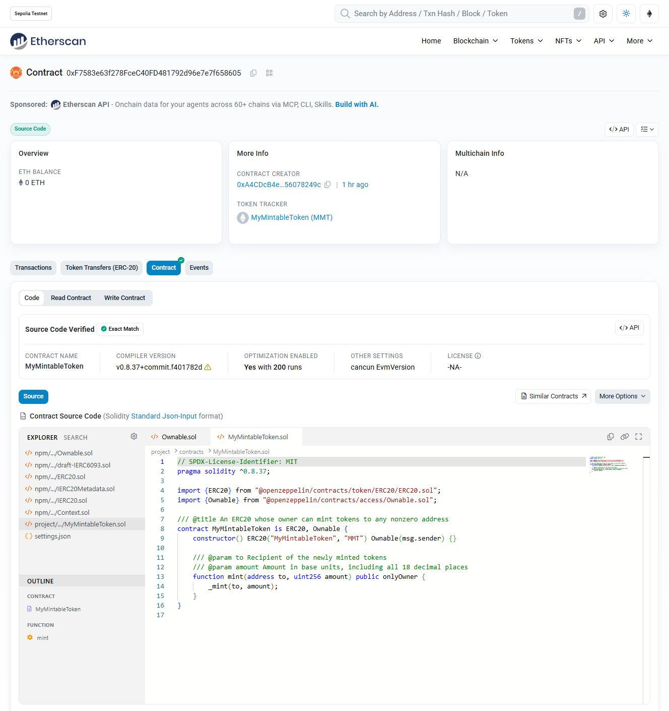

# Bài Tập 7.2 – Verify MyMintableToken trên Etherscan

🎯 Mục tiêu:

- Deploy contract ERC20 `MyMintableToken` trên Sepolia
- Verify contract trên Etherscan

---

## ✅ Bước 1 – Cài plugin verify

```bash
npm install --save-dev @nomicfoundation/hardhat-verify
```

---

## ✅ Bước 2 – Thêm cấu hình vào `hardhat.config.ts`

```ts
import "@nomicfoundation/hardhat-verify";

module.exports = {
  networks: {
    sepolia: {
      url: "https://sepolia.infura.io/v3/YOUR_INFURA_PROJECT_ID",
      accounts: ["YOUR_PRIVATE_KEY"],
    },
  },
  etherscan: {
    apiKey: "YOUR_ETHERSCAN_API_KEY",
  },
};
```

⚠️ **Không commit private key**

---

## ✅ Bước 3 – Deploy contract

```bash
npx hardhat run scripts/deploy.ts --network sepolia
```

Lưu lại địa chỉ contract.

---

## ✅ Bước 4 – Verify contract

```bash
npx hardhat verify --network sepolia DEPLOYED_CONTRACT_ADDRESS
```

---

## ✅ Bước 5 – Kiểm tra trên Etherscan

- Source code sẽ hiển thị công khai.
- Kiểm tra tab Read/Write Contract.

---

## 🎯 Yêu cầu nộp bài

- Địa chỉ contract
- Link verify trên Etherscan
- Screenshot verify thành công

---

## Lời giải thực tế — Hardhat 3

### Kết quả nộp bài

- Contract Sepolia: `0xF7583e63f278FceC40FD481792d96e7e7f658605`.
- [Source đã verify trên Etherscan](https://sepolia.etherscan.io/address/0xF7583e63f278FceC40FD481792d96e7e7f658605#code).
- Trạng thái: **Source Code Verified — Exact Match**.
- Tái sử dụng contract đã deploy ở bài 7.1; không deploy hoặc mint thêm.
- Owner/deployer: `0xA4CDcB4eFd9D4615586a6d78CB1283656078249c`.
- Số dư deployer và tổng cung: **1000.0 MMT**, tương đương `1000000000000000000000` đơn vị gốc; 18 decimals.
- [Báo cáo kiểm chứng](verification-result.json) ghi kết quả CLI, kiểm tra on-chain và đối chiếu tính nguyên vẹn.



### Cấu hình đúng với project

Ví dụ cấu hình trong đề bài phía trên dùng kiểu cấu hình cũ. Project thực tế dùng TypeScript/ESM và `export default defineConfig(...)` của Hardhat 3.

Giữ nguyên Hardhat **3.19.0**, OpenZeppelin **5.6.1**, ethers **6.17.0** và plugin verify **3.1.2** đã có qua toolbox; không cần chạy lại bước cài plugin.

Source Solidity được sao chép nguyên trạng từ bài 7.1. Hai profile `default` và `production` cùng dùng Solidity **0.8.37**, optimizer bật với **200 runs**, EVM **cancun**. Profile verify là `production`, khớp bytecode contract đã deploy.

```ts
export default defineConfig({
  verify: {
    etherscan: { enabled: true, apiKey: configVariable("ETHERSCAN_API_KEY") },
    blockscout: { enabled: false },
    sourcify: { enabled: false },
  },
});
```

Network Sepolia có chain ID `11155111` và `accounts: []`. Bài verify không cần private key hay signer.

### Cách chạy

Chạy các lệnh trong thư mục bài 7.2. `node_modules` là junction tới dependencies có sẵn; không chạy lệnh cài/nâng cấp thư viện qua junction.

Điền cấu hình vào `.env` theo `.env.example`:

```dotenv
SEPOLIA_RPC_URL=https://your-sepolia-rpc
ETHERSCAN_API_KEY=your-etherscan-api-key
```

`.env` được Git bỏ qua. Không ghi API key hoặc private key vào source, báo cáo hay ảnh chụp.

```powershell
npx hardhat compile --build-profile production
npm run typecheck
npm run check:sepolia
npx hardhat verify --network sepolia 0xF7583e63f278FceC40FD481792d96e7e7f658605
```

Cũng có thể dùng `npm run verify:sepolia` cho lệnh cuối. Constructor không có tham số.

`check:sepolia` chỉ đọc blockchain và xác nhận chain ID, bytecode, metadata, owner, số dư, tổng cung cùng hai receipt deploy/mint gốc. Nó không tạo giao dịch. Verify là yêu cầu HTTP tới Etherscan và không tốn gas.

Nếu máy thiếu bộ nhớ khi chạy các lệnh đồng thời, chạy tuần tự. Phiên thực thi đã dùng tùy chọn Node trong shell hiện tại:

```powershell
$env:NODE_OPTIONS = '--max-old-space-size=512 --max-semi-space-size=4'
```

### Kiểm chứng đã thực hiện

- Compile với profile `production`, typecheck và lint: thành công.
- Runtime bytecode trên Sepolia khớp artifact biên dịch tại bài 7.2.
- Owner, 18 decimals, số dư deployer và tổng cung: đúng đặc tả.
- Hardhat CLI trả mã 0 và thông báo `Contract verified successfully on Etherscan!`.
- Etherscan công khai source `MyMintableToken.sol`, hiển thị `Exact Match` và đúng thông số compiler.
- Đã mở Read Contract, xác nhận các hàm `owner`, `balanceOf`, `totalSupply`; đã mở Write Contract và xác nhận hàm `mint` mà không kết nối ví hay gửi giao dịch.
- Bài 7.1 và template được đối chiếu SHA-256 trước/sau; chi tiết trong báo cáo JSON.

### Tài liệu tham khảo

- [Hardhat 3: hardhat-verify](https://hardhat.org/docs/plugins/hardhat-verify).
